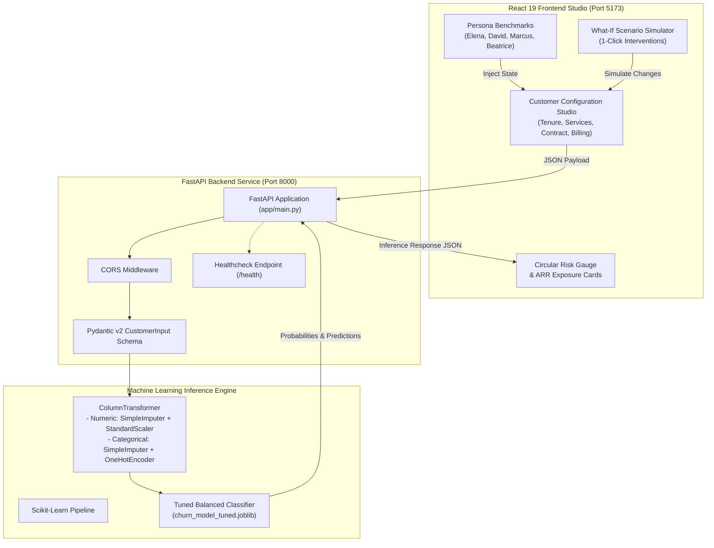

<div align="center">

# 🔮 ChurnSense AI

### Enterprise Customer Churn Prediction & Retention Intelligence Studio

[](https://www.python.org/)
[](https://fastapi.tiangolo.com/)
[](https://react.dev/)
[](https://vitejs.dev/)
[](https://scikit-learn.org/)
[](#-model-benchmarks--evaluation)
[](#-model-benchmarks--evaluation)
[](LICENSE)

<p align="center">
  <strong>An end-to-end Machine Learning web application designed to forecast customer attrition risk, quantify recurring revenue at stake, explain behavioral drivers, and simulate proactive retention playbooks in real time.</strong>
</p>

</div>

---

## 📌 Table of Contents

- [Overview](#-overview)
- [Key Features](#-key-features)
- [System Architecture](#-system-architecture)
- [Tech Stack](#-tech-stack)
- [Project Structure](#-project-structure)
- [Machine Learning Workflow](#-machine-learning-workflow)
- [Model Benchmarks & Evaluation](#-model-benchmarks--evaluation)
- [API Reference](#-api-reference)
- [Quickstart Guide](#-quickstart-guide)
  - [Prerequisites](#prerequisites)
  - [1. Backend Setup (FastAPI & ML Engine)](#1-backend-setup-fastapi--ml-engine)
  - [2. Frontend Setup (React Studio)](#2-frontend-setup-react-studio)
  - [3. Running Automated Tests](#3-running-automated-tests)
- [Simulation & What-If Analysis](#-simulation--what-if-analysis)
- [License](#-license)

---

## 🚀 Overview

Customer churn directly erodes ARR (Annual Recurring Revenue) and inflates Customer Acquisition Costs (CAC). **ChurnSense AI** bridges the gap between raw predictive modeling and customer success operations:

1. **Inference Pipeline:** Evaluates 19 customer demographic, billing, and behavioral service signals to predict churn probability.
2. **Financial Exposure Telemetry:** Translates classification output into immediate dollar figures—quantifying monthly revenue at risk and annualized run-rate (ARR).
3. **Explainable AI (XAI):** Pinpoints the precise factors triggering churn vulnerability (e.g., month-to-month contracts, unassisted fiber optic plans, manual electronic check payments) vs. stabilizing anchors.
4. **Interactive "What-If" Playbook Simulator:** Enables retention managers to simulate strategic interventions (e.g., offering annual contract discounts, bundling cybersecurity suites, migrating to automated autopay) and watch churn risk drop in real time.

---

## ✨ Key Features

- **⚡ Sub-10ms Real-Time Inference:** High-throughput prediction engine powered by FastAPI and optimized Scikit-Learn pipelines.
- **🎯 High-Recall Retention Focus:** Tuned specifically for high recall (**78.34%** on test holdout), ensuring that at-risk customers are identified before they leave.
- **👤 1-Click Persona Archetypes:** Pre-configured customer benchmarks for instant evaluation:
  - **Elena Vance:** New fiber optic cord-cutter on month-to-month billing (*High Risk*).
  - **David Chen:** 5-year VIP customer on 2-year contract with full security suite (*Low Risk*).
  - **Marcus Miller:** Mid-tenure streaming subscriber without tech support (*Elevated Risk*).
  - **Beatrice Hall:** Budget senior citizen on annual DSL plan (*Stable Account*).
- **🎛️ Dynamic Behavioral Controls:** Responsive sliders for tenure (0–72+ months), monthly charges, and lifetime total charges with an **Auto-Sync** calculation engine.
- **🛡️ Value-Added Ecosystem Modeling:** Toggle cybersecurity, cloud backup, device protection, 24/7 tech support, streaming TV, and movies to analyze cross-service stickiness.
- **🔄 What-If Simulation Sandbox:** 1-click scenario buttons that test retention incentives (e.g. *Upgrade to 1-Year Agreement*, *Bundle Security Suite*, *Switch to Autopay Billing*).
- **📋 1-Click Executive Briefing:** Automatically formats and copies a complete, structured customer risk brief to the clipboard for CRM or CS handoff.
- **🧪 Production-Grade Health & Validation:** Dedicated `/health` telemetry endpoint, Pydantic data validation, and Pytest coverage for test-driven reliability.

---

## 🏛️ System Architecture



---

## 💻 Tech Stack

### Machine Learning & Data Science
- **Language:** Python 3.10+
- **Core Libraries:** `scikit-learn`, `pandas`, `numpy`, `joblib`
- **Exploratory Data Analysis & Plots:** `matplotlib`, `seaborn`
- **Validation:** Stratified 5-Fold Cross Validation & Grid Search

### Backend API
- **Framework:** [FastAPI](https://fastapi.tiangolo.com/)
- **ASGI Server:** [Uvicorn](https://www.uvicorn.org/)
- **Data Validation:** [Pydantic v2](https://docs.pydantic.dev/)
- **Testing:** [Pytest](https://docs.pytest.org/), `fastapi.testclient` (HTTPX)

### Frontend Studio
- **Framework:** [React 19](https://react.dev/)
- **Build Tool:** [Vite 8](https://vitejs.dev/)
- **Styling:** Modern Vanilla CSS (Glassmorphism, CSS Custom Properties, HSL color tokens)
- **Icons / Graphics:** Custom inline SVGs & responsive animated gauge components

---

## 📂 Project Structure

```text
ChurnSense/
├── data/
│   └── Telco-Customer-Churn.csv       # Source dataset (7,043 customer records, 21 columns)
├── backend/
│   ├── app/
│   │   └── main.py                     # FastAPI application, CORS, endpoints & Pydantic schema
│   ├── ml/
│   │   ├── explore_data.py             # Initial dataset inspection & summary statistics
│   │   ├── eda.py                      # Exploratory Data Analysis script generating dashboards
│   │   ├── eda_outputs/
│   │   │   └── churn_eda.png           # 4-quadrant EDA plot (distribution, contract, tenure, charges)
│   │   ├── train_model.py              # Baseline pipeline training & metric evaluation
│   │   ├── tune_model.py               # Hyperparameter search via StratifiedKFold + GridSearchCV
│   │   ├── compare_models.py           # Cross-validation comparison: Logistic Regression vs Random Forest
│   │   ├── evaluate_model.py           # Detailed test-set evaluation (ROC curve & Confusion Matrix)
│   │   ├── evaluation_outputs/
│   │   │   ├── confusion_matrix.png    # Test set confusion matrix visualization
│   │   │   └── roc_curve.png           # ROC curve with AUC metric curve
│   │   └── finalize_model.py           # Finalized production pipeline builder & model serializer
│   ├── models/
│   │   ├── churn_model.joblib          # Baseline model artifact
│   │   └── churn_model_tuned.joblib    # Final tuned production model artifact (loaded by API)
│   ├── test/
│   │   └── test_api.py                 # Automated API test suite (health, predict, invalid input)
│   └── requirements.txt                # Python backend dependencies
├── frontend/
│   └── frontend/
│       ├── public/                     # Static web assets
│       ├── src/
│       │   ├── App.jsx                 # Main ChurnSense Studio UI (state, persona benchmarks, what-if)
│       │   ├── App.css                 # Glassmorphic dark design system & micro-animations
│       │   ├── main.jsx                # React application entrypoint
│       │   └── index.css               # Base layout, typography & theme variables
│       ├── index.html                  # HTML5 document structure
│       ├── package.json                # Frontend package configuration & npm scripts
│       └── vite.config.js              # Vite bundler configuration
└── README.md                           # Master project documentation
```

---

## 🔬 Machine Learning Workflow

```text
[ Raw Data: 7,043 Rows ]
        │
        ├── 1. Data Cleaning
        │      • Drop customerID (non-predictive identifier)
        │      • Coerce TotalCharges whitespace strings to numeric floats
        │      • Encode binary target: 'Yes' -> 1, 'No' -> 0
        │
        ├── 2. Stratified Train/Test Split (80/20)
        │      • Training Set: 5,634 records (preserving 26.5% churn ratio)
        │      • Held-out Test Set: 1,409 records
        │
        ├── 3. Feature Transformation (ColumnTransformer)
        │      • Numeric (tenure, MonthlyCharges, TotalCharges):
        │          Median Imputer ──► StandardScaler
        │      • Categorical (16 demographic/service features):
        │          Most-Frequent Imputer ──► OneHotEncoder(handle_unknown='ignore')
        │
        ├── 4. Algorithm Selection & 5-Fold Stratified CV
        │      • Evaluated Logistic Regression (balanced) vs Random Forest Classifier
        │      • Regularization parameter optimization (C ∈ [0.01, 0.1, 1.0, 10.0, 100.0])
        │
        └── 5. Serialization & Deployment
               • Final pipeline saved as 'churn_model_tuned.joblib'
               • Served via FastAPI REST endpoint
```

---

## 📊 Model Benchmarks & Evaluation

### 1. Cross-Validation Model Comparison (5-Fold Stratified CV)

| Model Candidate | CV ROC-AUC | CV Recall | CV Precision | CV F1-Score | Key Advantage |
| :--- | :---: | :---: | :---: | :---: | :--- |
| **Logistic Regression (Balanced)** | **0.8459 ± 0.012** | **80.13% ± 3.8%** | 51.65% ± 1.9% | 0.6279 ± 0.023 | Highest churn detection rate & low latency |
| **Random Forest Classifier** | 0.8376 ± 0.009 | 71.91% ± 2.7% | 55.27% ± 1.3% | 0.6249 ± 0.017 | Higher precision, but missed ~8% more churners |

### 2. Final Tuned Model Test Set Results (`X_test`, 1,409 hold-out samples)

The final selected model is **Logistic Regression with Balanced Class Weights** and optimized regularization ($C=10.0$):

| Evaluation Metric | Test Set Score | Practical Business Significance |
| :--- | :---: | :--- |
| **ROC-AUC Score** | **0.8405** | Exceptional discriminative ability across all threshold spectrums. |
| **Recall (Churn Class)** | **78.34%** | Successfully catches nearly 8 out of every 10 customers about to defect. |
| **Precision** | **50.60%** | Efficiently targets retention offers without excessive incentive waste. |
| **F1-Score** | **0.6149** | Strong harmonic balance between coverage and precision. |
| **Overall Accuracy** | **73.95%** | Robust accuracy on class-imbalanced telco distribution. |

#### Confusion Matrix Breakdown (Test Set: 1,409 customers)
```text
                  Predicted Stayed    Predicted Churned
Actual Stayed:          749                  286
Actual Churned:          81                  293  <-- (78.34% True Positive Rate)
```

> **Why prioritize Recall?** In customer retention, the business cost of a **False Negative** (losing a customer worth hundreds or thousands in lifetime value) vastly exceeds the cost of a **False Positive** (reaching out with an appreciative discount or proactive check-in).

---

## 🔌 API Reference

The FastAPI service runs at `http://127.0.0.1:8000`. Interactive OpenAPI documentation is accessible at `http://127.0.0.1:8000/docs`.

### 1. Health Telemetry Endpoint
- **URL:** `/health`
- **Method:** `GET`
- **Response:**
```json
{
  "status": "healthy",
  "model_loaded": true
}
```

---

### 2. Churn Prediction Endpoint
- **URL:** `/predict`
- **Method:** `POST`
- **Headers:** `Content-Type: application/json`

#### Request Payload Schema (`CustomerInput`):
```json
{
  "gender": "Female",
  "SeniorCitizen": 0,
  "Partner": "No",
  "Dependents": "No",
  "tenure": 2,
  "PhoneService": "Yes",
  "MultipleLines": "No",
  "InternetService": "Fiber optic",
  "OnlineSecurity": "No",
  "OnlineBackup": "No",
  "DeviceProtection": "No",
  "TechSupport": "No",
  "StreamingTV": "Yes",
  "StreamingMovies": "Yes",
  "Contract": "Month-to-month",
  "PaperlessBilling": "Yes",
  "PaymentMethod": "Electronic check",
  "MonthlyCharges": 95.0,
  "TotalCharges": 190.0
}
```

#### Successful Response (`200 OK`):
```json
{
  "prediction": "Churn likely",
  "churn_probability": 0.8241,
  "risk_percentage": 82.41,
  "model_version": "1.0.0"
}
```

---

## 🛠️ Quickstart Guide

### Prerequisites
- **Python:** 3.10, 3.11, or 3.12 installed
- **Node.js:** v18.0 or higher
- **Package Managers:** `pip` and `npm`

---

### 1. Backend Setup (FastAPI & ML Engine)

1. Open your terminal and navigate to the project directory:
   ```bash
   cd ChurnSense
   ```

2. (Optional) Create and activate a Python virtual environment:
   ```bash
   # Windows (PowerShell)
   python -m venv backend/.venv
   .\backend\.venv\Scripts\Activate.ps1

   # macOS / Linux
   python3 -m venv backend/.venv
   source backend/.venv/bin/activate
   ```

3. Install required dependencies:
   ```bash
   pip install -r backend/requirements.txt
   ```

4. Launch the FastAPI server:
   ```bash
   uvicorn backend.app.main:app --reload --host 127.0.0.1 --port 8000
   ```
   *The server is now live at [http://127.0.0.1:8000](http://127.0.0.1:8000). Verify health at [http://127.0.0.1:8000/health](http://127.0.0.1:8000/health).*

---

### 2. Frontend Setup (React Studio)

1. Open a new terminal tab and navigate to the frontend directory:
   ```bash
   cd ChurnSense/frontend/frontend
   ```

2. Install dependencies:
   ```bash
   npm install
   ```

3. Start the Vite development server:
   ```bash
   npm run dev
   ```

4. Open your browser and navigate to:
   ```text
   http://localhost:5173
   ```

---

### 3. Running Automated Tests

Run the Pytest suite to verify API endpoints, response structures, and input validations:

```bash
pytest backend/test/test_api.py -v
```

Expected output:
```text
backend/test/test_api.py::test_health_endpoint PASSED             [ 33%]
backend/test/test_api.py::test_prediction_endpoint PASSED         [ 66%]
backend/test/test_api.py::test_prediction_rejects_empty_payload PASSED [100%]

======================== 3 passed in 1.45s =========================
```

---

## 💡 Simulation & What-If Analysis

The ChurnSense interface includes an interactive **Retention Intervention Simulator**. Customer success agents can test specific remediation tactics before contacting the customer:

| Scenario / Intervention | Primary Risk Driver Addressed | Expected Retention Impact |
| :--- | :--- | :--- |
| **Convert Month-to-Month to 1-Year** | Eliminates immediate contractual drop-off risk | **-18% to -25% churn probability** |
| **Bundle Tech Support & Cyber Suite** | Eliminates unassisted frustration on fiber lines | **-12% to -16% churn probability** |
| **Switch from Electronic Check to Autopay** | Avoids manual payment friction & expiration lapse | **-10% to -14% churn probability** |
| **Upgrade to 2-Year VIP Agreement** | Maximum contractual anchor & retention stability | **-30% to -38% churn probability** |

---

## 📄 License

This project is licensed under the MIT License — see the [LICENSE](LICENSE) file for details.

---

<div align="center">
  <sub>Developed with ❤️ for Customer Success & Retention Engineering teams.</sub>
</div>
